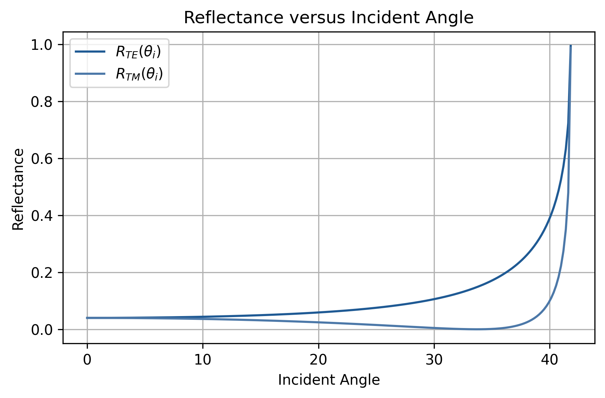
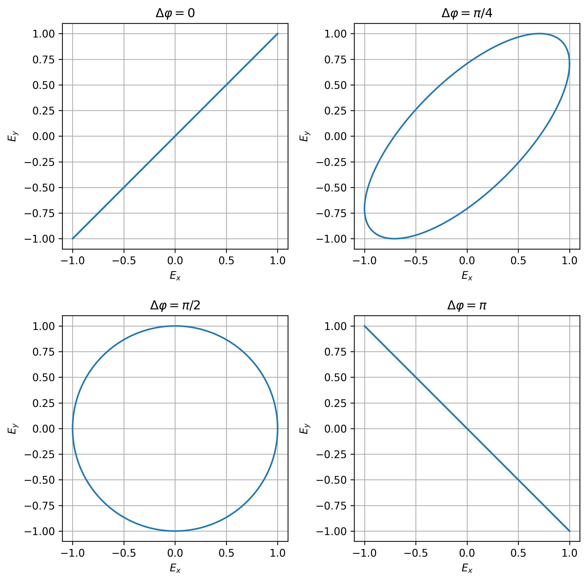
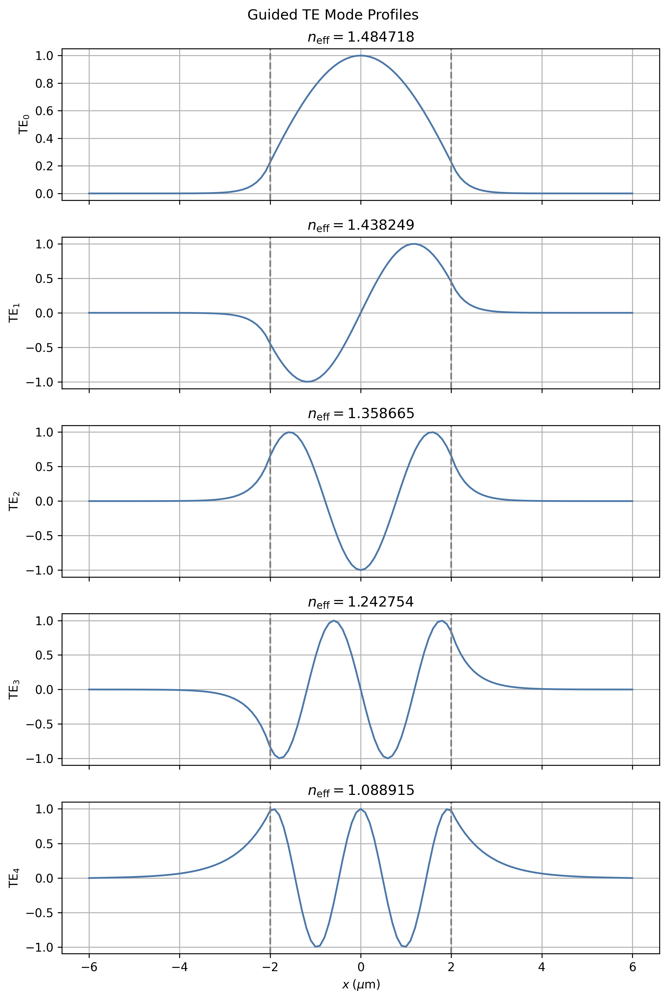
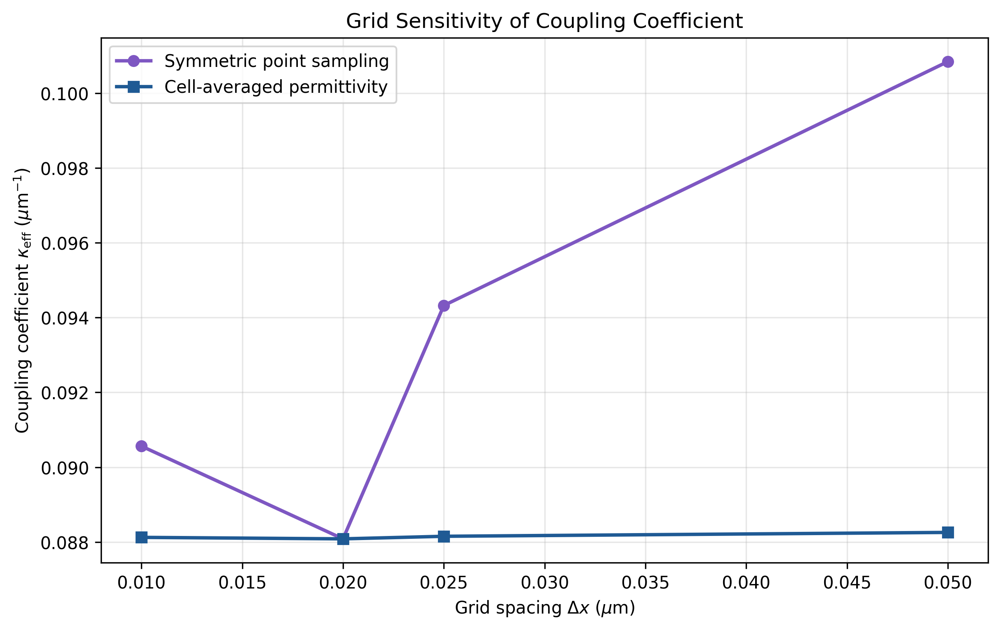
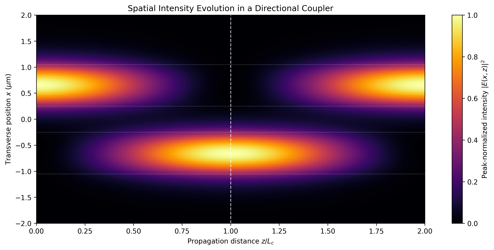
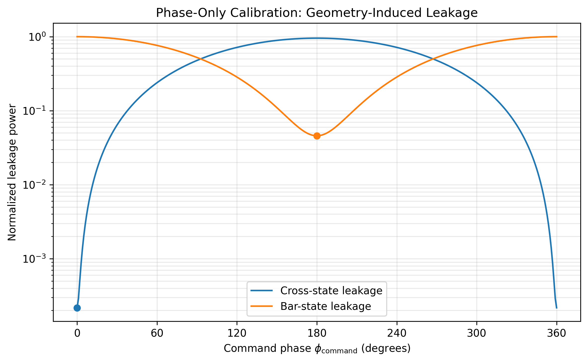

# From Maxwell's Equations to Programmable Photonic Circuits

*A Physics-Based Numerical Study of Waveguides, Directional Couplers, and Phase-Controlled Photonic Circuits*

An independent computational photonics project connecting classical electromagnetism, wave optics, guided-wave theory, and programmable photonic circuits through analytical solutions, numerical eigenmode analysis, and reduced-order device models.

**Current status (November 2026):** Conceptual and numerical
studies through Notebook 12 have been completed, covering
electromagnetic foundations, slab-waveguide eigenmodes,
directional coupling, Mach–Zehnder interferometers, and
programmable 2×2 optical transformations.

The current models investigate geometry-induced coupling
errors, transformation reachability, phase-only compensation,
and the distinction between optical transmission and
transformation fidelity.

Circuit-level calibration and statistical robustness
analysis remain the next major objectives.

## Project Overview

This project investigates how electromagnetic wave propagation, confinement, and coupling can be translated into controllable optical transformations.

The modeling progression is:

```text
Maxwell's equations
    ↓
Electromagnetic waves and dielectric interfaces
    ↓
Interference and polarization
    ↓
Dielectric waveguide eigenmodes
    ↓
Directional coupling and supermode splitting
    ↓
Mach–Zehnder interferometers
    ↓
Programmable photonic transformations
    ↓
Robustness and calibration
```

The purpose is not to develop a general-purpose full-wave electromagnetic simulator. Instead, the project constructs and verifies analytical and reduced-order numerical models, with particular attention to their assumptions, numerical reliability, and physical limitations.

The long-term research question is:

> How do waveguide-geometry variations, phase errors, and propagation losses affect the accuracy and calibratability of programmable photonic transformations?

The current studies establish a connected modeling hierarchy
from electromagnetic field equations to programmable optical
transformations. Waveguide eigenmode calculations provide
geometry-dependent coupling parameters, which are subsequently
used in reduced-order device and circuit models.

The project now investigates not only whether an optical
transformation can be implemented, but also how component
imperfections constrain its achievable accuracy, transmission,
and compensability.

## Current Status

| Notebook | Topic | Status |
|---|---|---|
| 00 | Mathematical foundations | In progress |
| 01–03 | Electrostatics, electric potential, conductors, and dielectrics | Completed studies |
| 04–05 | Magnetostatics, magnetic forces, and materials | Completed studies |
| 06 | Maxwell's equations and electromagnetic induction | Completed |
| 07 | Electromagnetic waves and dielectric interfaces | Completed |
| 08 | Superposition, polarization, interference, and Jones matrices | Completed |
| 09 | Dielectric waveguide modes and numerical eigenmode analysis | Completed |
| 10 | Directional couplers and coupled-mode theory | Completed |
| 11 | Mach–Zehnder interferometers and switching robustness | Completed |
| 12 | Programmable photonic transformations | Completed |
| 13 | Circuit-level calibration and robustness | Planned |

Here, completion refers to the primary conceptual and notebook-level numerical studies. It does not imply that all automated regression tests, historical corrections, or independent device-level validation have been completed.

## Research Questions

The project develops through several connected physical questions:

1. How do Maxwell's equations describe electromagnetic wave propagation in dielectric media?
2. How do boundary conditions, relative phase, and polarization determine optical field behavior?
3. How do dielectric waveguides support discrete guided modes, and under what numerical conditions can these modes be calculated reliably?
4. How does evanescent-field overlap determine the coupling coefficient between neighboring waveguides?
5. How do waveguide-geometry variations propagate into directional-coupler and MZI switching errors?
6. Which device imperfections can be compensated through phase control, and which produce unavoidable leakage within a specified circuit architecture?
7. How do these device-level effects ultimately influence programmable optical transformations?

## Methodology

The project follows a physics-first numerical methodology:

1. **Physical question:** Identify a specific physical mechanism or computational question.
2. **Model formulation:** Define geometry, governing equations, assumptions, and observables.
3. **Analytical reference:** Derive a reference solution, limiting relation, or physical constraint whenever possible.
4. **Numerical implementation:** Construct the minimum computational model needed to answer the question.
5. **Verification:** Compare independent solution methods, conservation properties, analytical references, and numerical convergence.
6. **Targeted numerical experiment:** Examine controlled variations of physically meaningful parameters.
7. **Interpretation and limitations:** Explain the observed behavior and distinguish model-level agreement from physical validation.

Reusable numerical calculations are maintained in [`notebooks/src`](notebooks/src), while physical interpretation and parameter-dependent experiments remain in the corresponding notebooks.

## Completed Numerical Studies

### 1. Electromagnetic Foundations — Notebooks 01–06

The first stage establishes the classical electromagnetic foundations of integrated photonics.

Representative studies include:

- Electric fields and potentials generated by point charges.
- Verification of the relationship $\mathbf{E}=-\nabla V$.
- Dielectric response and layered capacitors.
- Numerical Biot–Savart integration.
- Finite-wire convergence toward the infinite-wire limit.
- The magnetic dipole approximation.
- Maxwell's equations and the electromagnetic wave equation.

These studies provide the physical foundations for subsequent guided-wave and photonic-device models.

Some historical calculations have documented corrections that remain outstanding; see [`docs/errata.md`](docs/errata.md).

### 2. Electromagnetic Waves and Dielectric Interfaces — Notebook 07

[Notebook 07](notebooks/07_electromagnetic_waves_and_dielectric_interfaces.ipynb) investigates wave propagation across dielectric boundaries.

Topics include:

- Harmonic electromagnetic waves.
- Poynting vector and time-averaged intensity.
- Electromagnetic boundary conditions.
- Snell's law and Fresnel coefficients.
- TE/TM reflection and transmission.
- Brewster angle and critical angle.
- Total internal reflection and evanescent penetration.

For lossless interfaces below the critical angle, power conservation is examined through

$$\epsilon_{\mathrm{power}}=|R+T-1|.$$



### 3. Interference, Polarization, and Jones Matrices — Notebook 08

[Notebook 08](notebooks/08_wave_superposition_polarization_and_interference.ipynb) examines the relationship between complex electromagnetic amplitudes and observable optical intensity.

The numerical studies cover:

- Two-wave interference and relative phase.
- Interference visibility under amplitude imbalance.
- Linear, circular, and elliptical polarization.
- Jones-vector representation.
- Phase retardation and polarization transformations.
- Analyzer projection and Malus's law.
- Norm conservation under unitary Jones transformations.

Representative comparisons with analytical intensity expressions produce maximum absolute errors on the order of $10^{-15}$.

These results establish the phase-to-intensity and linear-transformation principles used in subsequent MZI modeling.



### 4. Dielectric Slab Waveguide Eigenmodes — Notebook 09

[Notebook 09](notebooks/09_guided_waves_and_dielectric_waveguide_modes.ipynb) develops a one-dimensional finite-difference eigenmode solver for dielectric slab waveguides.

For a TE mode, the transverse field satisfies

$$\frac{d^2\psi}{dx^2}+[k_0^2n^2(x)-\beta^2]\psi=0.$$

The corresponding discrete eigenvalue problem is

$$
\left[D_2+k_0^2\mathrm{diag}(n^2)\right]
\boldsymbol{\psi} = \beta^2\boldsymbol{\psi},$$

where $D_2$ represents the finite-difference approximation
of the transverse second-derivative operator.

The study investigates:

- Guided-mode selection and effective refractive index.
- Symmetric-slab dispersion relations.
- Mode profiles and parity.
- Finite-difference operator construction.
- Grid and computational-domain convergence.
- Analytical–numerical comparisons.
- Higher-order mode cutoff and core-thickness dependence.

**Key findings**

The reference symmetric slab supports five guided TE modes under the selected conditions.

The study also identifies stronger computational-boundary sensitivity for higher-order modes near cutoff.

Although the central-difference operator is formally second-order accurate in smooth regions, the present discrete representation of the step-index interface produces approximately first-order global convergence in the investigated effective indices.

This distinction illustrates how numerical treatment of material discontinuities can determine the accuracy of an eigenmode calculation.



### 5. Directional Couplers and Coupled-Mode Theory — Notebook 10

[Notebook 10](notebooks/10_directional_couplers_and_coupled_mode_theory.ipynb) examines how evanescent coupling between two dielectric slab waveguides produces periodic optical power transfer.

#### Case 1 — Two-mode propagation verification

The coupled-mode system is modeled as

$$\frac{d\mathbf a}{dz}=-iH\mathbf a.$$

Three solution methods are compared:

- Analytical solution.
- Matrix exponential.
- Numerical ODE integration using RK45.

The analytical and matrix-exponential solutions agree to near machine precision. Tighter integration tolerances reduce the ODE solution error and the power-conservation residual.

#### Case 2 — Supermode splitting and gap-dependent coupling

The finite-difference eigenmode solver developed in Notebook 09 is reused to calculate the even and odd supermodes of a symmetric two-waveguide structure.

The effective coupling coefficient is determined from the propagation-constant splitting:

$$\kappa_{\mathrm{eff}}=\frac{|\beta_+-\beta_-|}{2}.$$

The waveguide gap is varied to examine the coupling coefficient and corresponding coupling length.

Over the investigated range, an approximately exponential relationship is observed:

$$\kappa(g)\approx\kappa(g_0)e^{-\gamma(g-g_0)}.$$

The fitted decay coefficient is

$$\gamma_{\mathrm{fit}}=2.73806\;\mu\mathrm{m}^{-1}.$$

Its relative difference from the isolated TE₀ evanescent decay coefficient is approximately **0.55%**.

This agreement supports the role of evanescent-field overlap in determining gap-dependent coupling within the selected slab-waveguide model.



[View the evanescent decay and coupling comparison](figures/10_directional_couplers_and_coupled_mode_theory/case_02_Evanescent_Decay_and_Gap_Dependent_Coupling.png)

#### Case 3 — Spatial field evolution and modal projection

The FDM-derived supermodes are combined to reconstruct the transverse optical field during propagation.

Projection onto a localized-mode basis is compared with the corresponding CMT representation.

The maximum complex-amplitude discrepancy is approximately

$$1.77\times10^{-14}.
$$

The study also demonstrates that localized modal fractions and spatially integrated intensity fractions are not generally identical. Their difference reaches approximately 2.04 percentage points under the investigated conditions.

The results establish consistency between the supermode representation and the reduced two-mode CMT formulation, rather than independent full-wave electromagnetic validation.



### 6. Mach–Zehnder Interferometers — Notebook 11

[Notebook 11](notebooks/11_mach_zehnder_interferometers.ipynb) extends the directional-coupler model to phase-controlled optical switching and examines how geometry-dependent coupling imperfections affect MZI performance.

The MZI transfer matrix is constructed as

$$U_{\mathrm{MZI}}=C(\theta_2)P(\phi)C(\theta_1),$$

where

$$C(\theta)=
\begin{bmatrix}
\cos\theta & -i\sin\theta\\
-i\sin\theta & \cos\theta
\end{bmatrix},
\qquad
P(\phi)=
\begin{bmatrix}
1&0\\
0&e^{i\phi}
\end{bmatrix}.
$$

The coupling angles are linked to the waveguide geometry through

$$\theta_j=\kappa(g_j)L_{\mathrm{DC}}.$$

This establishes a reduced-order connection from waveguide geometry to circuit-level switching behavior.

#### Case 1 — Ideal MZI verification

An ideal MZI with two 50:50 couplers is used as the analytical reference.

The expected single-port output powers are

$$P_1=\sin^2\left(\frac{\phi}{2}\right),\qquad P_2=\cos^2\left(\frac{\phi}{2}\right).$$

Numerical verification includes:

- Analytical switching response.
- Cross, equal-splitting, and bar states.
- Matrix unitarity.
- Conservation of total optical power.

Representative numerical results:

| Verification metric | Maximum residual |
|---|---:|
| Output power versus analytical formula | $8.88\times10^{-16}$ |
| Unitarity, $\|U^\dagger U-I\|_F$ | $9.46\times10^{-16}$ |
| Input–output power discrepancy | $6.66\times10^{-16}$ |

The results verify the transfer-matrix implementation for the ideal lossless system.

#### Case 2 — Geometry-induced coupling errors

This case investigates how perturbations in the two directional-coupler gaps affect MZI switching.

The coupling model obtained in Notebook 10 is used to calculate perturbed coupling angles while holding the physical coupler length fixed.

The study distinguishes common-mode and differential-mode gap variations.

For sufficiently small perturbations $\delta g$, the analytical model predicts:

| Perturbation | Switching state | Leading leakage scaling |
|---|---|---|
| Common-mode gap error | Cross | $O(\delta g^2)$ |
| Differential-mode gap error | Cross | $O(\delta g^4)$ |
| Differential-mode gap error | Bar | $O(\delta g^2)$ |

These scaling laws are compared with numerical log–log fits over specified perturbation intervals.

The results demonstrate that switching sensitivity depends not only on the magnitude of fabrication-like variations but also on their correlation between the two couplers and on the selected switching state.

For the investigated differential perturbation of $\pm0.05\,\mu\mathrm m$, the FDM-derived coupling coefficients predict approximately 0.0242% cross-state leakage and 4.6077% bar-state leakage at the nominal switching phases.

These results are based on a one-dimensional dielectric model with prescribed geometric perturbations, not measured fabrication statistics.

#### Case 3 — Phase calibration and switching recovery

This case examines whether adjusting the relative phase can compensate for a constant phase-setting offset or geometry-dependent coupling errors.

The applied phase is modeled by

$$\phi_{\mathrm{actual}}=\phi_{\mathrm{command}}+\delta\phi.$$

A discrete phase sweep is used to minimize the unwanted output-port power.

For ideal couplers, a constant $2^\circ$ phase offset is compensated by a $358^\circ$ phase command, reducing leakage to numerical precision.

For a $2.3^\circ$ phase offset, the one-degree command grid leaves a minimum leakage of approximately $6.85\times10^{-6}$, demonstrating the distinction between physical compensability and finite parameter-sampling resolution.

When the coupler gaps are perturbed, the phase sweep reveals residual leakage even at the optimal phase.

For the investigated exponential coupling model with opposite gap shifts of $\pm0.05\,\mu\mathrm m$, the minimum leakage fractions are approximately:

- Cross state: 0.02173%.
- Bar state: 4.5817%.

Analytical calculations reproduce these model-level leakage floors.

**Physical conclusion**

Phase tuning can compensate for a constant phase-setting offset in an ideal MZI. However, coupling-angle imperfections change the amplitudes of interfering fields and can impose state-dependent leakage floors that cannot generally be removed by controlling the relative phase alone.

This identifies a limitation of phase-only calibration within the investigated MZI architecture.



The numerical studies in Notebook 11 do not yet establish a general circuit-level calibration method or include quantitative propagation-loss simulations.

### 7. Programmable Photonic Transformations — Notebook 12

[Notebook 12](notebooks/12_programmable_photonic_transformations.ipynb) extends the MZI model developed in Notebook 11 to programmable complex optical transformations.

Additional input and output phase shifters are introduced to expand the accessible transformation space:

$$
U(\alpha,\phi,\beta)
=
D_{\mathrm{out}}(\alpha)
C(\theta_2)P(\phi)C(\theta_1)
D_{\mathrm{in}}(\beta).
$$

For ideal 50:50 couplers, this architecture can implement an arbitrary $2\times2$ unitary transformation up to a global phase.

#### Case 1 — Target unitary synthesis

An analytical phase-synthesis method is developed to determine the control parameters required to reproduce a prescribed unitary transformation.

The numerical implementation accounts for both general unitary matrices and special diagonal or off-diagonal cases.

Representative reconstruction results after global-phase alignment are:

| Target transformation | Relative reconstruction error |
|---|---:|
| Identity | $2.38\times10^{-16}$ |
| SWAP | $2.30\times10^{-16}$ |
| Complex unitary | $3.22\times10^{-16}$ |

These results verify the analytical synthesis procedure within the ideal reduced-order matrix model.

#### Case 2 — Coupling errors and transformation reachability

The geometry-dependent coupling model obtained in Notebooks 10 and 11 is reused to investigate the effect of nonideal directional couplers.

For coupling angles satisfying $0\leq\theta_1,\theta_2\leq\pi/2$, the accessible mixing-ratio interval is

$$\cos^2(\theta_1+\theta_2)\leq |U_{11}|^2\leq \cos^2(\theta_1-\theta_2).$$

This interval determines whether a prescribed unitary transformation is reachable through phase control alone.

The transformation accuracy is evaluated using the global-phase-invariant shape fidelity:

$$F_{\mathrm{shape}}=\frac{|\mathrm{Tr}(U_t^\dagger U)|^2}{2\mathrm{Tr}(U^\dagger U)},$$

where $U_t$ is a unitary target and $U$ is nonzero.

For a target mixing ratio $p_t$ and an achievable mixing ratio $p$, optimal phase alignment in the lossless model gives

$$F_{\max}(p)=\left[\sqrt{p_tp}+\sqrt{(1-p_t)(1-p)}\right]^2.$$

Representative maximum achievable fidelities for prescribed gap perturbations of $0.05\,\mu\mathrm{m}$ are:

| Target | Ideal | Common-mode error | Differential-mode error |
|---|---:|---:|---:|
| Identity | 1.000000 | 1.000000 | 0.954183 |
| SWAP | 1.000000 | 0.960150 | 0.999783 |
| Complex unitary | 1.000000 | 1.000000 | 1.000000 |

Analytical fidelity bounds are compared with explicitly constructed optical transformation matrices, with agreement near machine precision.

The results demonstrate that a lossless circuit is not necessarily universally programmable. Coupling imperfections can restrict the accessible transformation space even when all optical power is conserved.

#### Case 3 — Optical loss and transformation fidelity

Optical attenuation is introduced through an arm-dependent loss matrix:

$$L=\begin{bmatrix}
\sqrt{\eta_1}&0\\
0&\sqrt{\eta_2}
\end{bmatrix},
$$

where $\eta_1$ and $\eta_2$ represent the power transmission of the two MZI arms.

Transformation fidelity and average optical transmission are evaluated separately:

$$T_{\mathrm{avg}}=\frac{\mathrm{Tr}(U^\dagger U)}{2}.$$

| Loss condition | Shape fidelity | Average transmission |
|---|---:|---:|
| Uniform: $\eta_1=\eta_2=0.65$ | 1.000000 | 0.65 |
| Differential: $\eta_1=0.90,\ \eta_2=0.40$ | 0.961538 | 0.65 |

Uniform attenuation preserves the relative shape of the target transformation, whereas differential attenuation can distort the implemented transformation even when the average transmission remains unchanged.

The input-dependent transmission is further examined through the Rayleigh quotient:

$$T(\mathbf a)=\frac{\mathbf a^\dagger U^\dagger U\mathbf a}{\mathbf a^\dagger\mathbf a}.$$

For the investigated loss model,

$$\min(\eta_1,\eta_2)\leq T(\mathbf a)\leq \max(\eta_1,\eta_2).$$

Numerical experiments reproduce these transmission bounds using appropriately selected coherent input states.

**Physical conclusion**

The performance of a programmable photonic circuit cannot be characterized by optical transmission or unitarity alone. Transformation reachability, shape fidelity, and input-dependent transmission describe distinct aspects of circuit performance.

These results establish the analytical and numerical foundations for subsequent calibration and robustness studies.

The model remains a reduced-order, coherent two-port representation with prescribed coupling and attenuation parameters. It does not constitute experimental validation or a full-vector simulation of a fabricated photonic device.

### 7. Programmable Photonic Transformations — Notebook 12

[Notebook 12](notebooks/12_programmable_photonic_transformations.ipynb) extends the MZI model developed in Notebook 11 to programmable complex optical transformations.

Additional input and output phase shifters are introduced to expand the accessible transformation space:

$$ U(\alpha,\phi,\beta)=D_{\mathrm{out}}(\alpha)C(\theta_2)P(\phi)C(\theta_1)D_{\mathrm{in}}(\beta).$$

For ideal 50:50 couplers, this architecture can implement an arbitrary $2\times2$ unitary transformation up to a global phase.

#### Case 1 — Target unitary synthesis

An analytical phase-synthesis method is developed to determine the control parameters required to reproduce a prescribed unitary transformation.

The numerical implementation accounts for both general unitary matrices and special diagonal or off-diagonal cases.

Representative reconstruction results after global-phase alignment are:

| Target transformation | Relative reconstruction error |
|---|---:|
| Identity | $2.38\times10^{-16}$ |
| SWAP | $2.30\times10^{-16}$ |
| Complex unitary | $3.22\times10^{-16}$ |

These results verify the analytical synthesis procedure within the ideal reduced-order matrix model.

#### Case 2 — Coupling errors and transformation reachability

The geometry-dependent coupling model obtained in Notebooks 10 and 11 is reused to investigate the effect of nonideal directional couplers.

For coupling angles satisfying $0\leq\theta_1,\theta_2\leq\pi/2$, the accessible mixing-ratio interval is

$$\cos^2(\theta_1+\theta_2)\leq |U_{11}|^2\leq \cos^2(\theta_1-\theta_2).$$

This interval determines whether a prescribed unitary transformation is reachable through phase control alone.

The transformation accuracy is evaluated using the global-phase-invariant shape fidelity:

$$F_{\mathrm{shape}}=\frac{|\mathrm{Tr}(U_t^\dagger U)|^2
}{2\mathrm{Tr}(U^\dagger U)},$$

where $U_t$ is a unitary target and $U$ is nonzero.

For a target mixing ratio $p_t$ and an achievable mixing ratio $p$, optimal phase alignment in the lossless model gives

$$F_{\max}(p)=\left[\sqrt{p_tp}+\sqrt{(1-p_t)(1-p)}\right]^2.$$

Representative maximum achievable fidelities for prescribed gap perturbations of $0.05\,\mu\mathrm{m}$ are:

| Target | Ideal | Common-mode error | Differential-mode error |
|---|---:|---:|---:|
| Identity | 1.000000 | 1.000000 | 0.954183 |
| SWAP | 1.000000 | 0.960150 | 0.999783 |
| Complex unitary | 1.000000 | 1.000000 | 1.000000 |

Analytical fidelity bounds are compared with explicitly constructed optical transformation matrices, with agreement near machine precision.

The results demonstrate that a lossless circuit is not necessarily universally programmable. Coupling imperfections can restrict the accessible transformation space even when all optical power is conserved.

#### Case 3 — Optical loss and transformation fidelity

Optical attenuation is introduced through an arm-dependent loss matrix:

$$L=\begin{bmatrix}\sqrt{\eta_1}&0\\0&\sqrt{\eta_2}\end{bmatrix},$$

where $\eta_1$ and $\eta_2$ represent the power transmission of the two MZI arms.

Transformation fidelity and average optical transmission are evaluated separately:

$$T_{\mathrm{avg}}=\frac{\mathrm{Tr}(U^\dagger U)}{2}.$$

| Loss condition | Shape fidelity | Average transmission |
|---|---:|---:|
| Uniform: $\eta_1=\eta_2=0.65$ | 1.000000 | 0.65 |
| Differential: $\eta_1=0.90,\ \eta_2=0.40$ | 0.961538 | 0.65 |

Uniform attenuation preserves the relative shape of the target transformation, whereas differential attenuation can distort the implemented transformation even when the average transmission remains unchanged.

The input-dependent transmission is further examined through the Rayleigh quotient:

$$T(\mathbf a)=\frac{\mathbf a^\dagger U^\dagger U\mathbf a}{\mathbf a^\dagger\mathbf a}.$$

For the investigated loss model,

$$\min(\eta_1,\eta_2)\leq T(\mathbf a)\leq \max(\eta_1,\eta_2).$$

Numerical experiments reproduce these transmission bounds using appropriately selected coherent input states.

**Physical conclusion**

The performance of a programmable photonic circuit cannot be characterized by optical transmission or unitarity alone. Transformation reachability, shape fidelity, and input-dependent transmission describe distinct aspects of circuit performance.

These results establish the analytical and numerical foundations for subsequent calibration and robustness studies.

The model remains a reduced-order, coherent two-port representation with prescribed coupling and attenuation parameters. It does not constitute experimental validation or a full-vector simulation of a fabricated photonic device.

## Numerical Verification and Reliability

The project applies several complementary verification strategies:

- Analytical–numerical solution comparisons.
- Absolute and relative error calculations.
- Conservation laws and unitarity.
- Physical admissibility and limiting behavior.
- Grid and computational-domain convergence.
- Complex-amplitude and phase comparisons.
- Agreement between independently formulated numerical solution methods, where available.

The main reusable verification functions are maintained in [`notebooks/src/verification.py`](notebooks/src/verification.py).

Selected automated regression tests are maintained in
[`tests/`](tests/), covering:

- Optical interface calculations and conservation laws.
- General numerical verification utilities.
- Waveguide eigenmode calculations and analytical references.
- Coupled-mode propagation and supermode splitting.
- MZI transfer matrices and unitarity.
- Analytical unitary synthesis and random unitary targets.
- Geometry-dependent transformation reachability.
- Uniform and differential attenuation.
- Input-dependent optical transmission.
- Invalid model inputs and boundary cases.

These tests complement notebook-level numerical experiments
and help detect regressions when reusable computational
modules are modified.

Passing the automated tests does not establish the absence
of all historical errors or provide independent experimental
validation.

### Known issues and reproducibility

Historical numerical and implementation issues are tracked in [`docs/errata.md`](docs/errata.md). The documented corrections have not all been applied and reverified.

Notebook-level numerical agreement must not be interpreted as experimental validation. In particular, agreement between supermode reconstruction and CMT within the same reduced modal basis does not establish agreement with independent full-vector electromagnetic calculations.

### Research Record and Revision Policy

The notebooks are maintained as cumulative records of the
learning, modeling, and numerical investigation process.

Earlier derivations, computational prototypes, and numerical
results may be retained to preserve the development history
of the project.

Identified errors and subsequent corrections are documented
in notebook-level errata and the centralized
[`docs/errata.md`](docs/errata.md).

Where an error affects quantitative conclusions, corrected
calculations and reverification results are documented
separately from the historical results.

Reusable source modules and automated tests, in contrast,
are updated directly to maintain their current correctness
and reliability.

Documented corrections are distinguished from proposed
corrections that have not yet been fully reverified.

## Repository Structure

```text
.
├── notebooks/
│   ├── 00_mathematical_foundations.ipynb
│   ├── 01_... through 08_...
│   ├── 09_guided_waves_and_dielectric_waveguide_modes.ipynb
│   ├── 10_directional_couplers_and_coupled_mode_theory.ipynb
│   ├── 11_mach_zehnder_interferometers.ipynb
│   ├── 12_programmable_photonic_transformations.ipynb
│   └── src/
│       ├── optics.py
│       ├── waveguide.py
│       ├── coupler.py
│       ├── mzi.py
│       ├── programmable.py
│       ├── verification.py
│       └── other electromagnetic models
├── figures/
│   └── exported numerical results
├── tests/
│   ├── test_optics.py
│   ├── test_waveguide.py
│   ├── test_coupler.py
│   ├── test_programmable.py
│   └── test_verification.py
├── docs/
│   └── errata.md
├── references/
├── daily_logs/
├── requirements.txt
└── README.md
```

Additional placeholder files are present in the repository and have not yet been finalized.

## Installation and Execution

The repository records Python 3.14.3 as the environment used for its current notebook outputs. Dependency versions are not pinned, and exact environment reproducibility has not yet been established.

Clone the repository:

```bash
git clone https://github.com/hyerim1212/maxwell-to-programmable-photonics.git
cd maxwell-to-programmable-photonics
```

Create a virtual environment:

```bash
python -m venv .venv
```

Activate it on Windows:

```powershell
.venv\Scripts\activate
```

Or on macOS/Linux:

```bash
source .venv/bin/activate
```

Install dependencies:

```bash
python -m pip install --upgrade pip
python -m pip install -r requirements.txt
```

Launch Jupyter:

```bash
jupyter lab
```

Run the default-discovered automated tests:

```bash
python -m pytest tests/
```

The coupler test file currently requires explicit selection or renaming to be included in default pytest discovery. Passing these tests does not imply that the outstanding issues in `docs/errata.md` have been resolved.

## Scope and Limitations

The computational models primarily assume:

- Classical electromagnetic fields.
- Linear and isotropic dielectric materials.
- Harmonic or monochromatic excitation.
- One-dimensional scalar or TE waveguide formulations.
- Reduced two-mode descriptions for directional coupling.
- Coherent, power-normalized optical modal amplitudes.
- Reduced-order component and transfer-matrix models.
- Prescribed geometric perturbations and optical attenuation.
- Ideal phase control unless explicitly perturbed.

The repository currently does not provide:

- A general-purpose full-vector 2D/3D electromagnetic solver.
- Experimentally calibrated device or fabrication parameters.
- Material-specific or distributed propagation-loss modeling.
- Detailed electromagnetic modeling of reflection,
  scattering, or parasitic mode coupling.
- Large-scale programmable photonic mesh simulations.
- Completed statistical robustness analysis.
- Measurement-based circuit calibration.
- Complete closure of all documented historical corrections.

Optical loss is currently represented by prescribed
arm-dependent attenuation rather than being independently
calculated from material and waveguide properties.

The numerical results are intended as physical modeling
and verification studies, not quantitative predictions
of a specific fabricated photonic device.

## Next Steps

### Notebook 13 — Calibration and Robustness

The final numerical study will investigate the combined
effects of component imperfections on programmable optical
transformations.

The planned investigations include:

- Simultaneous coupling, phase-setting, and attenuation errors.
- Model-based phase-only calibration.
- Comparison with analytical reachability and fidelity bounds.
- Distinction between numerical optimization error and
  physical limitations of compensability.
- Statistical robustness under controlled parameter variations.
- Identification of calibration failure regimes.

### Final Project Consolidation

- Extend regression tests for the final circuit models.
- Document corrected results and complete necessary reverification.
- Consolidate representative numerical figures.
- Prepare a technical report describing the modeling hierarchy,
  principal findings, and limitations.
- Connect the computational results with selected
  integrated-photonics research literature.
- Document reproducibility and the final computational environment.

## References

Primary textbooks and research articles are listed in [`references/README.md`](references/README.md).

Major references include:

- Griffiths, *Introduction to Electrodynamics*.
- Hecht, *Optics*.
- Pollock and Lipson, *Integrated Photonics*.
- Chrostowski and Hochberg, *Silicon Photonics Design: From Devices to Systems*.
- Han et al., “Large-scale silicon photonic switches with movable directional couplers,” *Optica* (2015).

## License Status

No license terms have been finalized. The existing `LICENSE` file is currently a placeholder and does not specify a reuse license.
