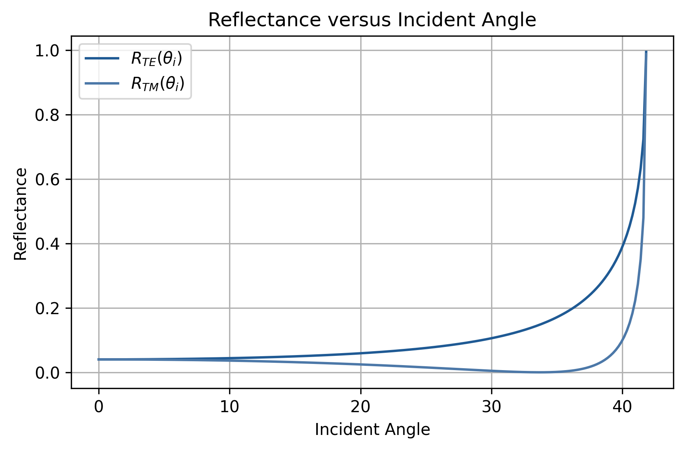
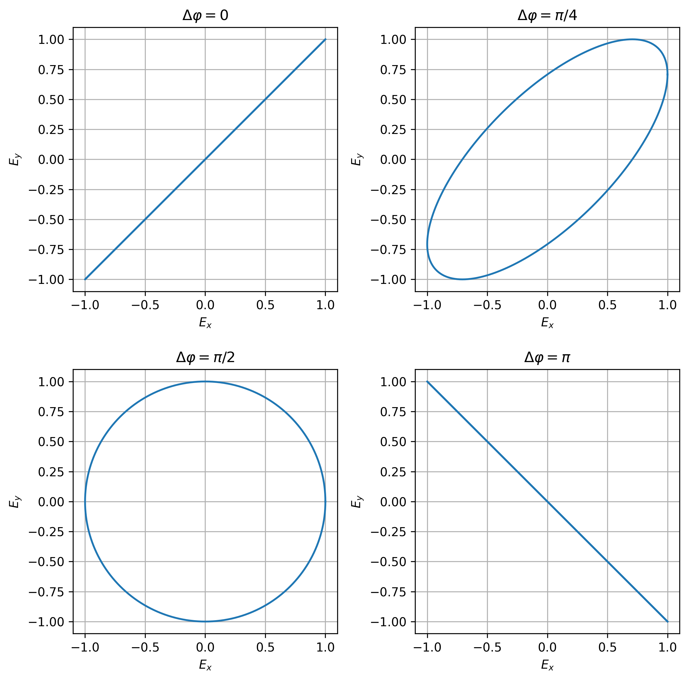
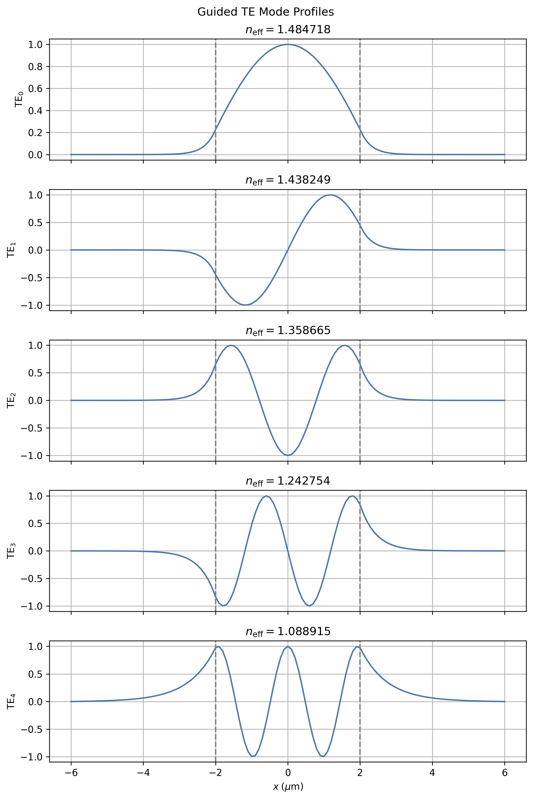
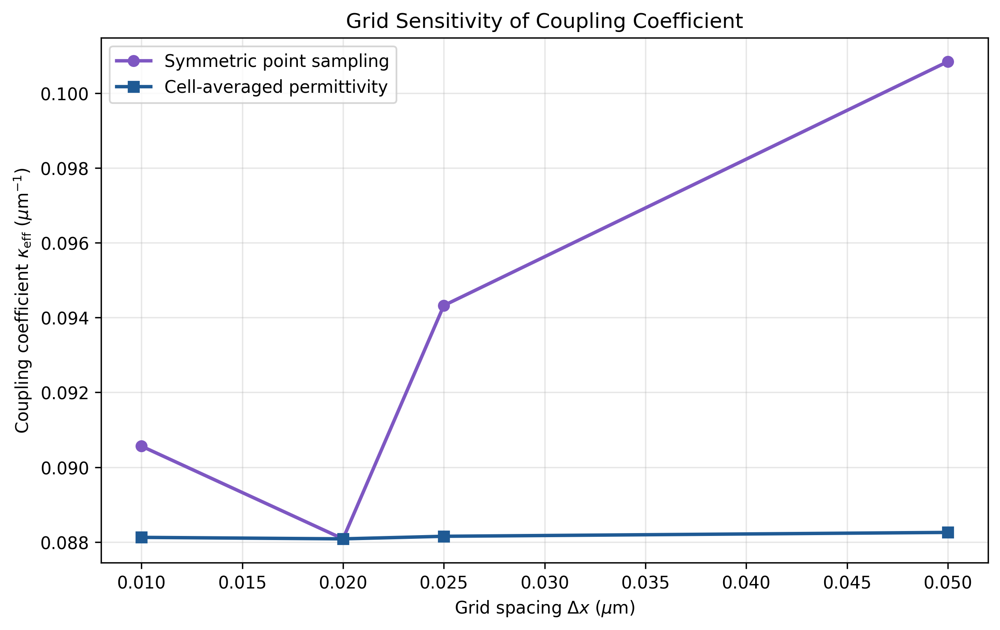
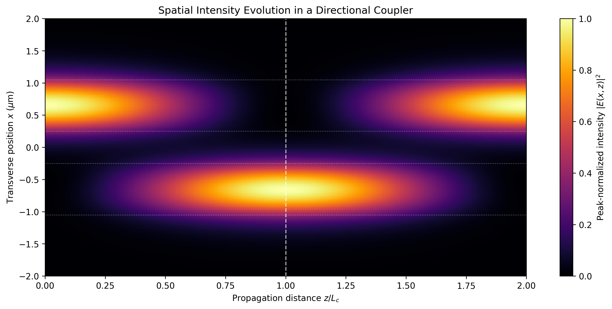
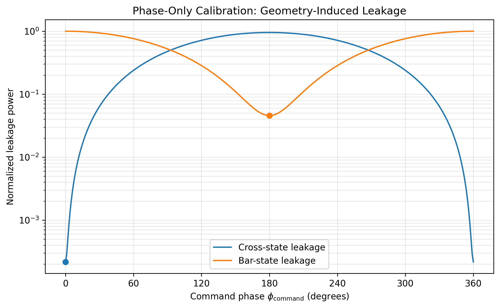

# From Maxwell's Equations to Programmable Photonic Circuits

*A Physics-Based Numerical Study of Waveguides, Directional Couplers, and Phase-Controlled Photonic Circuits*

An independent computational photonics project connecting classical electromagnetism, wave optics, guided-wave theory, and programmable photonic circuits through analytical solutions, numerical eigenmode analysis, and reduced-order device models.

**Current status (October 2026):** Numerical studies through Notebook 11 have been carried out, including slab-waveguide eigenmodes, directional coupling, Mach–Zehnder switching, geometry-induced leakage, and phase-only calibration. Repository-level testing and documentation remain under development.

## Project Overview

This project investigates how electromagnetic wave propagation, confinement, and coupling can be translated into controllable optical transformations.

The modeling progression is:

```text
Maxwell's equations
    ↓
Electromagnetic waves and dielectric interfaces
    ↓
Interference and polarization
    ↓
Dielectric waveguide eigenmodes
    ↓
Directional coupling and supermode splitting
    ↓
Mach–Zehnder interferometers
    ↓
Programmable photonic transformations
    ↓
Robustness and calibration
```

The purpose is not to develop a general-purpose full-wave electromagnetic simulator. Instead, the project constructs and verifies analytical and reduced-order numerical models, with particular attention to their assumptions, numerical reliability, and physical limitations.

The long-term research question is:

> How do waveguide-geometry variations, phase errors, and propagation losses affect the accuracy and calibratability of programmable photonic transformations?

The current numerical studies establish the waveguide, coupler, and single-MZI components needed to investigate this question at the circuit level.

## Current Status

| Notebook | Topic | Status |
|---|---|---|
| 00 | Mathematical foundations | In progress |
| 01–03 | Electrostatics, electric potential, conductors, and dielectrics | Completed studies |
| 04–05 | Magnetostatics, magnetic forces, and materials | Completed studies |
| 06 | Maxwell's equations and electromagnetic induction | Completed |
| 07 | Electromagnetic waves and dielectric interfaces | Completed |
| 08 | Superposition, polarization, interference, and Jones matrices | Completed |
| 09 | Dielectric waveguide modes and numerical eigenmode analysis | Completed |
| 10 | Directional couplers and coupled-mode theory | Completed |
| 11 | Mach–Zehnder interferometers and switching robustness | Three numerical cases implemented |
| 12 | Programmable photonic transformations | Planned |
| 13 | Circuit-level calibration and robustness | Planned |

Here, completion refers to the primary conceptual and notebook-level numerical studies. It does not imply that all automated regression tests, historical corrections, or independent device-level validation have been completed.

## Research Questions

The project develops through several connected physical questions:

1. How do Maxwell's equations describe electromagnetic wave propagation in dielectric media?
2. How do boundary conditions, relative phase, and polarization determine optical field behavior?
3. How do dielectric waveguides support discrete guided modes, and under what numerical conditions can these modes be calculated reliably?
4. How does evanescent-field overlap determine the coupling coefficient between neighboring waveguides?
5. How do waveguide-geometry variations propagate into directional-coupler and MZI switching errors?
6. Which device imperfections can be compensated through phase control, and which produce unavoidable leakage within a specified circuit architecture?
7. How do these device-level effects ultimately influence programmable optical transformations?

## Methodology

The project follows a physics-first numerical methodology:

1. **Physical question:** Identify a specific physical mechanism or computational question.
2. **Model formulation:** Define geometry, governing equations, assumptions, and observables.
3. **Analytical reference:** Derive a reference solution, limiting relation, or physical constraint whenever possible.
4. **Numerical implementation:** Construct the minimum computational model needed to answer the question.
5. **Verification:** Compare independent solution methods, conservation properties, analytical references, and numerical convergence.
6. **Targeted numerical experiment:** Examine controlled variations of physically meaningful parameters.
7. **Interpretation and limitations:** Explain the observed behavior and distinguish model-level agreement from physical validation.

Reusable numerical calculations are maintained in [`notebooks/src`](notebooks/src), while physical interpretation and parameter-dependent experiments remain in the corresponding notebooks.

## Completed Numerical Studies

### 1. Electromagnetic Foundations — Notebooks 01–06

The first stage establishes the classical electromagnetic foundations of integrated photonics.

Representative studies include:

- Electric fields and potentials generated by point charges.
- Verification of the relationship $\mathbf{E}=-\nabla V$.
- Dielectric response and layered capacitors.
- Numerical Biot–Savart integration.
- Finite-wire convergence toward the infinite-wire limit.
- The magnetic dipole approximation.
- Maxwell's equations and the electromagnetic wave equation.

These studies provide the physical foundations for subsequent guided-wave and photonic-device models.

Some historical calculations have documented corrections that remain outstanding; see [`docs/errata.md`](docs/errata.md).

### 2. Electromagnetic Waves and Dielectric Interfaces — Notebook 07

[Notebook 07](notebooks/07_electromagnetic_waves_and_dielectric_interfaces.ipynb) investigates wave propagation across dielectric boundaries.

Topics include:

- Harmonic electromagnetic waves.
- Poynting vector and time-averaged intensity.
- Electromagnetic boundary conditions.
- Snell's law and Fresnel coefficients.
- TE/TM reflection and transmission.
- Brewster angle and critical angle.
- Total internal reflection and evanescent penetration.

For lossless interfaces below the critical angle, power conservation is examined through

$$\epsilon_{\mathrm{power}}=|R+T-1|.$$



### 3. Interference, Polarization, and Jones Matrices — Notebook 08

[Notebook 08](notebooks/08_wave_superposition_polarization_and_interference.ipynb) examines the relationship between complex electromagnetic amplitudes and observable optical intensity.

The numerical studies cover:

- Two-wave interference and relative phase.
- Interference visibility under amplitude imbalance.
- Linear, circular, and elliptical polarization.
- Jones-vector representation.
- Phase retardation and polarization transformations.
- Analyzer projection and Malus's law.
- Norm conservation under unitary Jones transformations.

Representative comparisons with analytical intensity expressions produce maximum absolute errors on the order of $10^{-15}$.

These results establish the phase-to-intensity and linear-transformation principles used in subsequent MZI modeling.



### 4. Dielectric Slab Waveguide Eigenmodes — Notebook 09

[Notebook 09](notebooks/09_guided_waves_and_dielectric_waveguide_modes.ipynb) develops a one-dimensional finite-difference eigenmode solver for dielectric slab waveguides.

For a TE mode, the transverse field satisfies

$$\frac{d^2\psi}{dx^2}+[k_0^2n^2(x)-\beta^2]\psi=0.$$

The corresponding discrete eigenvalue problem is

$$\beta^2\boldsymbol{\psi}.$$

The study investigates:

- Guided-mode selection and effective refractive index.
- Symmetric-slab dispersion relations.
- Mode profiles and parity.
- Finite-difference operator construction.
- Grid and computational-domain convergence.
- Analytical–numerical comparisons.
- Higher-order mode cutoff and core-thickness dependence.

**Key findings**

The reference symmetric slab supports five guided TE modes under the selected conditions.

The study also identifies stronger computational-boundary sensitivity for higher-order modes near cutoff.

Although the central-difference operator is formally second-order accurate in smooth regions, the present discrete representation of the step-index interface produces approximately first-order global convergence in the investigated effective indices.

This distinction illustrates how numerical treatment of material discontinuities can determine the accuracy of an eigenmode calculation.



### 5. Directional Couplers and Coupled-Mode Theory — Notebook 10

[Notebook 10](notebooks/10_directional_couplers_and_coupled_mode_theory.ipynb) examines how evanescent coupling between two dielectric slab waveguides produces periodic optical power transfer.

#### Case 1 — Two-mode propagation verification

The coupled-mode system is modeled as

$$\frac{d\mathbf a}{dz}=-iH\mathbf a.$$

Three solution methods are compared:

- Analytical solution.
- Matrix exponential.
- Numerical ODE integration using RK45.

The analytical and matrix-exponential solutions agree to near machine precision. Tighter integration tolerances reduce the ODE solution error and the power-conservation residual.

#### Case 2 — Supermode splitting and gap-dependent coupling

The finite-difference eigenmode solver developed in Notebook 09 is reused to calculate the even and odd supermodes of a symmetric two-waveguide structure.

The effective coupling coefficient is determined from the propagation-constant splitting:

$$\kappa_{\mathrm{eff}}=\frac{|\beta_+-\beta_-|}{2}.$$

The waveguide gap is varied to examine the coupling coefficient and corresponding coupling length.

Over the investigated range, an approximately exponential relationship is observed:

$$\kappa(g)\approx\kappa(g_0)e^{-\gamma(g-g_0)}.$$

The fitted decay coefficient is

$$\gamma_{\mathrm{fit}}=2.73806\;\mu\mathrm{m}^{-1}.$$

Its relative difference from the isolated TE₀ evanescent decay coefficient is approximately **0.55%**.

This agreement supports the role of evanescent-field overlap in determining gap-dependent coupling within the selected slab-waveguide model.



[View the evanescent decay and coupling comparison](figures/10_directional_couplers_and_coupled_mode_theory/case_02_Evanescent_Decay_and_Gap_Dependent_Coupling.png)

#### Case 3 — Spatial field evolution and modal projection

The FDM-derived supermodes are combined to reconstruct the transverse optical field during propagation.

Projection onto a localized-mode basis is compared with the corresponding CMT representation.

The maximum complex-amplitude discrepancy is approximately

$$1.77\times10^{-14}.
$$

The study also demonstrates that localized modal fractions and spatially integrated intensity fractions are not generally identical. Their difference reaches approximately 2.04 percentage points under the investigated conditions.

The results establish consistency between the supermode representation and the reduced two-mode CMT formulation, rather than independent full-wave electromagnetic validation.



### 6. Mach–Zehnder Interferometers — Notebook 11

[Notebook 11](notebooks/11_mach_zehnder_interferometers.ipynb) extends the directional-coupler model to phase-controlled optical switching and examines how geometry-dependent coupling imperfections affect MZI performance.

The MZI transfer matrix is constructed as

$$U_{\mathrm{MZI}}=C(\theta_2)P(\phi)C(\theta_1),$$

where

$$C(\theta)=
\begin{bmatrix}
\cos\theta & -i\sin\theta\\
-i\sin\theta & \cos\theta
\end{bmatrix},
\qquad
P(\phi)=
\begin{bmatrix}
1&0\\
0&e^{i\phi}
\end{bmatrix}.
$$

The coupling angles are linked to the waveguide geometry through

$$\theta_j=\kappa(g_j)L_{\mathrm{DC}}.$$

This establishes a reduced-order connection from waveguide geometry to circuit-level switching behavior.

#### Case 1 — Ideal MZI verification

An ideal MZI with two 50:50 couplers is used as the analytical reference.

The expected single-port output powers are

$$P_1=\sin^2\left(\frac{\phi}{2}\right),\qquad P_2=\cos^2\left(\frac{\phi}{2}\right).$$

Numerical verification includes:

- Analytical switching response.
- Cross, equal-splitting, and bar states.
- Matrix unitarity.
- Conservation of total optical power.

Representative numerical results:

| Verification metric | Maximum residual |
|---|---:|
| Output power versus analytical formula | $8.88\times10^{-16}$ |
| Unitarity, $\|U^\dagger U-I\|_F$ | $9.46\times10^{-16}$ |
| Input–output power discrepancy | $6.66\times10^{-16}$ |

The results verify the transfer-matrix implementation for the ideal lossless system.

#### Case 2 — Geometry-induced coupling errors

This case investigates how perturbations in the two directional-coupler gaps affect MZI switching.

The coupling model obtained in Notebook 10 is used to calculate perturbed coupling angles while holding the physical coupler length fixed.

The study distinguishes common-mode and differential-mode gap variations.

For sufficiently small perturbations $\delta g$, the analytical model predicts:

| Perturbation | Switching state | Leading leakage scaling |
|---|---|---|
| Common-mode gap error | Cross | $O(\delta g^2)$ |
| Differential-mode gap error | Cross | $O(\delta g^4)$ |
| Differential-mode gap error | Bar | $O(\delta g^2)$ |

These scaling laws are compared with numerical log–log fits over specified perturbation intervals.

The results demonstrate that switching sensitivity depends not only on the magnitude of fabrication-like variations but also on their correlation between the two couplers and on the selected switching state.

For the investigated differential perturbation of $\pm0.05\,\mu\mathrm m$, the FDM-derived coupling coefficients predict approximately 0.0242% cross-state leakage and 4.6077% bar-state leakage at the nominal switching phases.

These results are based on a one-dimensional dielectric model with prescribed geometric perturbations, not measured fabrication statistics.

#### Case 3 — Phase calibration and switching recovery

This case examines whether adjusting the relative phase can compensate for a constant phase-setting offset or geometry-dependent coupling errors.

The applied phase is modeled by

$$\phi_{\mathrm{actual}}=\phi_{\mathrm{command}}+\delta\phi.$$

A discrete phase sweep is used to minimize the unwanted output-port power.

For ideal couplers, a constant $2^\circ$ phase offset is compensated by a $358^\circ$ phase command, reducing leakage to numerical precision.

For a $2.3^\circ$ phase offset, the one-degree command grid leaves a minimum leakage of approximately $6.85\times10^{-6}$, demonstrating the distinction between physical compensability and finite parameter-sampling resolution.

When the coupler gaps are perturbed, the phase sweep reveals residual leakage even at the optimal phase.

For the investigated exponential coupling model with opposite gap shifts of $\pm0.05\,\mu\mathrm m$, the minimum leakage fractions are approximately:

- Cross state: 0.02173%.
- Bar state: 4.5817%.

Analytical calculations reproduce these model-level leakage floors.

**Physical conclusion**

Phase tuning can compensate for a constant phase-setting offset in an ideal MZI. However, coupling-angle imperfections change the amplitudes of interfering fields and can impose state-dependent leakage floors that cannot generally be removed by controlling the relative phase alone.

This identifies a limitation of phase-only calibration within the investigated MZI architecture.



The numerical studies in Notebook 11 do not yet establish a general circuit-level calibration method or include quantitative propagation-loss simulations.

## Numerical Verification and Reliability

The project applies several complementary verification strategies:

- Analytical–numerical solution comparisons.
- Absolute and relative error calculations.
- Conservation laws and unitarity.
- Physical admissibility and limiting behavior.
- Grid and computational-domain convergence.
- Complex-amplitude and phase comparisons.
- Agreement between independently formulated numerical solution methods, where available.

The main reusable verification functions are maintained in [`notebooks/src/verification.py`](notebooks/src/verification.py).

Selected automated tests are implemented in [`tests/`](tests/), covering optical calculations, verification utilities, and waveguide models. Coupler regression tests have also been written, but their current filename, `text_coupler.py`, does not match the default pytest test-file discovery pattern.

Automated MZI regression tests and broader repository-level testing remain outstanding.

### Known issues and reproducibility

Historical numerical and implementation issues are tracked in [`docs/errata.md`](docs/errata.md). The documented corrections have not all been applied and reverified.

Notebook-level numerical agreement must not be interpreted as experimental validation. In particular, agreement between supermode reconstruction and CMT within the same reduced modal basis does not establish agreement with independent full-vector electromagnetic calculations.

## Repository Structure

```text
.
├── notebooks/
│   ├── 00_mathematical_foundations.ipynb
│   ├── 01_... through 08_...
│   ├── 09_guided_waves_and_dielectric_waveguide_modes.ipynb
│   ├── 10_directional_couplers_and_coupled_mode_theory.ipynb
│   ├── 11_mach_zehnder_interferometers.ipynb
│   └── src/
│       ├── coupler.py
│       ├── waveguide.py
│       ├── optics.py
│       ├── verification.py
│       └── other electromagnetic models
├── figures/
│   └── exported numerical results
├── tests/
│   └── regression tests and test utilities
├── docs/
│   └── errata.md
├── references/
├── daily_logs/
├── requirements.txt
└── README.md
```

Additional placeholder files are present in the repository and have not yet been finalized.

## Installation and Execution

The repository records Python 3.14.3 as the environment used for its current notebook outputs. Dependency versions are not pinned, and exact environment reproducibility has not yet been established.

Clone the repository:

```bash
git clone https://github.com/hyerim1212/maxwell-to-programmable-photonics.git
cd maxwell-to-programmable-photonics
```

Create a virtual environment:

```bash
python -m venv .venv
```

Activate it on Windows:

```powershell
.venv\Scripts\activate
```

Or on macOS/Linux:

```bash
source .venv/bin/activate
```

Install dependencies:

```bash
python -m pip install --upgrade pip
python -m pip install -r requirements.txt
```

Launch Jupyter:

```bash
jupyter lab
```

Run the default-discovered automated tests:

```bash
python -m pytest tests/
```

The coupler test file currently requires explicit selection or renaming to be included in default pytest discovery. Passing these tests does not imply that the outstanding issues in `docs/errata.md` have been resolved.

## Scope and Limitations

The computational models primarily assume:

- Classical electromagnetic fields.
- Linear and isotropic dielectric materials.
- Harmonic or monochromatic excitation.
- One-dimensional scalar or TE waveguide formulations for the primary eigenmode calculations.
- Reduced two-mode descriptions for directional coupling.
- Idealized lossless optical components in the numerical MZI studies.

The repository currently does not provide:

- A general-purpose full-vector 2D/3D electromagnetic solver.
- Experimentally calibrated device or fabrication parameters.
- Quantitative propagation-loss simulations for the MZI numerical cases.
- A completed programmable multi-component circuit study.
- Full circuit-level calibration and Monte Carlo robustness analysis.
- Complete automated regression coverage and closure of all documented errata.

The numerical results are therefore intended as physical modeling and verification studies, not predictions of a specific fabricated photonic device.

## Next Steps

The next phase will extend the verified device-level models toward programmable optical transformations.

**Notebook 12 — Programmable photonic transformations**

- Construct a small phase-controlled 2×2 photonic transformation.
- Determine the target operations achievable with the chosen architecture.
- Compare target and implemented transformations using physically appropriate metrics.
- Examine coupling errors, phase errors, and propagation loss while distinguishing transformation accuracy from optical transmission.

**Notebook 13 — Calibration and robustness**

- Investigate phase-only calibration at the circuit level.
- Determine which device imperfections can be compensated.
- Examine robustness through controlled perturbations and, where appropriate, Monte Carlo analysis.
- Identify performance degradation and failure regimes.

**Final project consolidation**

- Expand regression coverage and reverify documented corrections.
- Select representative results for a technical report.
- Document the complete modeling hierarchy and its limitations.
- Connect the computational findings with selected integrated-photonics research literature.

## References

Primary textbooks and research articles are listed in [`references/README.md`](references/README.md).

Major references include:

- Griffiths, *Introduction to Electrodynamics*.
- Hecht, *Optics*.
- Pollock and Lipson, *Integrated Photonics*.
- Chrostowski and Hochberg, *Silicon Photonics Design: From Devices to Systems*.
- Han et al., “Large-scale silicon photonic switches with movable directional couplers,” *Optica* (2015).

## License Status

No license terms have been finalized. The existing `LICENSE` file is currently a placeholder and does not specify a reuse license.
